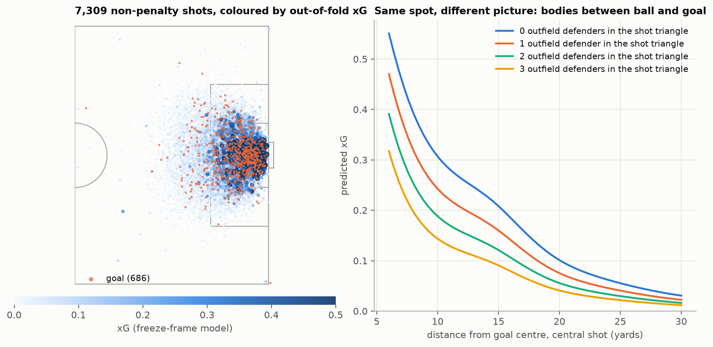
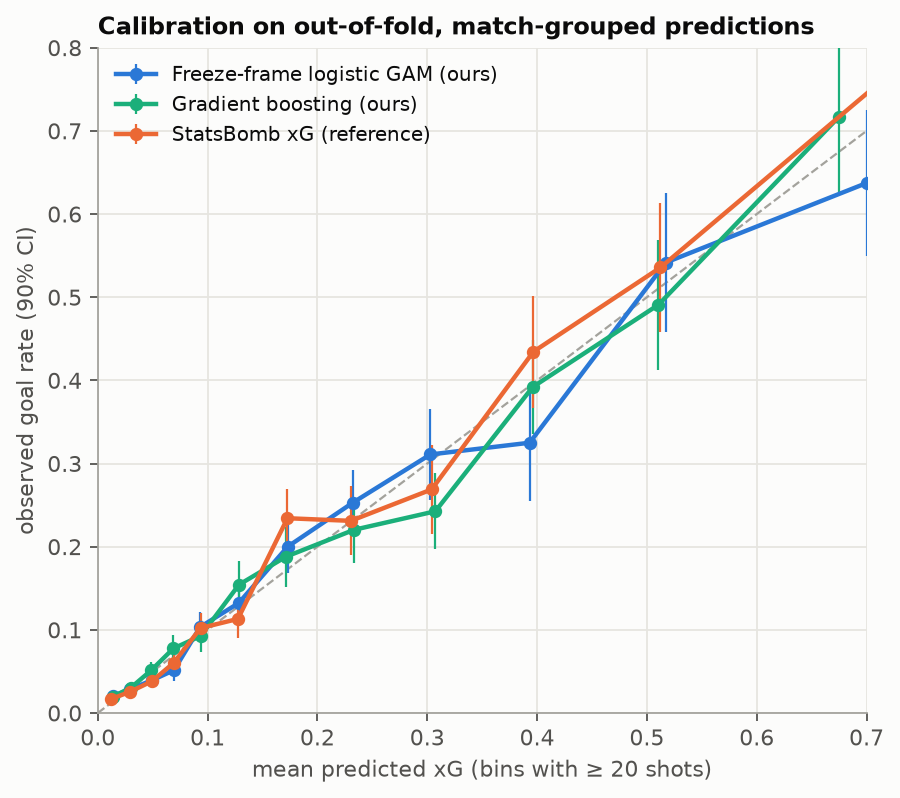
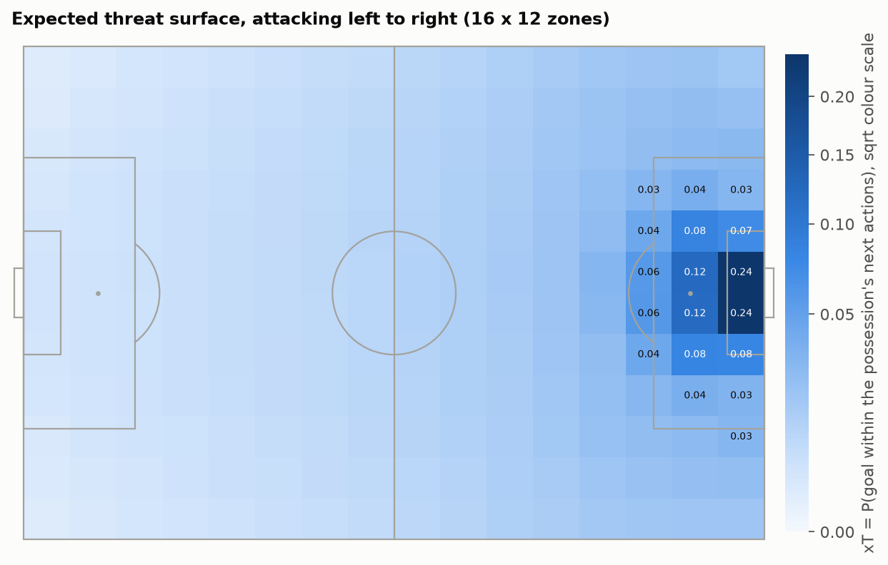
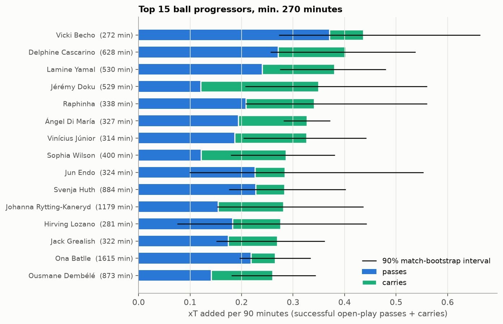
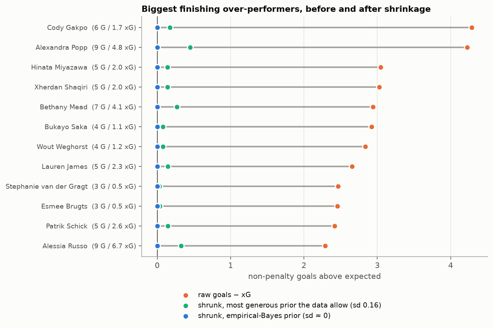

# Which shots and which passes actually create goals?

[](https://github.com/lukahere007/soccer-xg-xt/actions/workflows/ci.yml)

[](LICENSE)

<a href="https://statsbomb.com"></a>

> **Data: StatsBomb Open Data.** Event data provided by [StatsBomb](https://statsbomb.com) via
> [statsbomb/open-data](https://github.com/statsbomb/open-data).

This project uses **292 international tournament matches** from StatsBomb Open Data
(men's World Cup 2022, Euro 2020 and Euro 2024; Women's World Cup 2023, Women's Euro 2022 and 2025)
to answer three questions:

1. **Shots.** What makes a shot likely to go in? I built an expected-goals (xG) model from the geometry of the moment the shot is taken: where the shooter is, where the goalkeeper stands, and how many bodies are between the ball and the goal.
2. **Passes.** Which passes and carries move the ball to where goals come from? I used expected threat (xT), a Markov-chain value for every zone of the pitch.
3. **Finishing.** When a player scores more than their xG, how much of that is skill and how much is luck?

## Answer first

**Shots: the picture in front of the shooter matters about as much as the spot.**

- Adding freeze-frame geometry to a distance-and-angle model cuts out-of-fold log loss by **0.0154** (95% match-bootstrap CI 0.0112 to 0.0197). That is the largest single gain in the table below.
- Take a central shot from the penalty spot with the keeper on his line and no outfield defender in the shooter→post→post triangle. The model gives it **0.24 xG**. With two defenders in that triangle it drops to **0.14**. With a defender 1 yard from the shooter it drops to **0.15**.
- The raw numbers tell the same story. Inside 18 yards, shots with a clear triangle score **19.4%** of the time (1,993 shots). With one defender in the triangle that falls to **10.7%**, and with four or more to **2.4%**.
- Goals come from a small set of shots. Shots worth more than 0.30 xG are **5.3%** of non-penalty shots but **25.2%** of goals. Shots worth less than 0.05 xG are 47% of shots and only 13% of goals.

**Passes: threat is created by getting the ball into the box.**

- Successful passes *into* the penalty area are **2.0%** of successful open-play passes but carry **34%** of all positive xT added by passes.
- The xT surface is nearly flat across the first two-thirds of the pitch: **0.004** in a team's own box and **0.012** at the centre circle. It peaks at **0.24** in the central zones of the six-yard area.
- The top ball progressors per 90 minutes (minimum 270 minutes) are wide creators. Lamine Yamal (0.38 xT/90, 90% interval 0.27 to 0.48) gets about 60% of his from passes. Jérémy Doku (0.35) gets two-thirds of his from carries. Delphine Cascarino (0.40) and Vicki Becho (0.44, from only 272 minutes) top the women's tournaments.

**Finishing: in tournament samples it is almost all noise.**

- Across 1,415 shooters, the spread of goals − xG is only **2%** larger than pure Bernoulli luck would produce.
- The empirical-Bayes prior collapses to "everyone is an average finisher". I also used the most generous skill spread the data cannot reject (prior sd 0.16). Under that prior, the 12 biggest over-performers keep only **6%** of their raw goals-above-xG on average.
- Cody Gakpo's +4.3 (6 goals from 1.7 xG) shrinks to **+0.2**.

## xG model comparison

Non-penalty shots (7,309 shots, 686 goals). All predictions are **out-of-fold from 5-fold cross-validation grouped by match**, with the regularisation strength picked by inner grouped CV (nested). Penalties are handled separately: 71 of 103 scored (69%).

| Model | Log loss | Brier | ROC AUC | Calib. slope |
|---|---|---|---|---|
| Base rate (constant) | 0.3114 | 0.0850 | – | – |
| Geometry logistic (spline distance + spline angle + body part) | 0.2734 | 0.0768 | 0.753 | 1.00 |
| **Freeze-frame logistic GAM (ours)** | **0.2580** | **0.0727** | **0.792** | **0.99** |
| Gradient boosting (ours, same inputs) | 0.2582 | 0.0725 | 0.787 | 0.94 |
| StatsBomb xG (reference) | 0.2494 | 0.0697 | 0.806 | 1.06 |

- **Interpretable beats black box here.** Gradient boosting minus the GAM is +0.0003 log loss (CI −0.0028 to +0.0034), which is a tie. The additive model is the one I can explain term by term, so it is the headline model.
- **StatsBomb's own xG is better, by 0.0085 log loss (CI 0.0052 to 0.0117).** That is expected, and it does not mean the method is wrong:
  1. StatsBomb trains on hundreds of thousands of shots across many leagues and seasons; I have 7,309.
  2. Their model uses inputs I don't rebuild, such as the height of the ball at the moment of the shot and more detailed goalkeeper and pass information.
  3. Their model was very likely trained on data that includes these very matches. For them this is not an out-of-sample test; for me it strictly is.

  My model closes about **64%** of the gap between the textbook geometry model and StatsBomb's, using only 15 hand-built, explainable inputs.





All three models are well calibrated on held-out matches. Calibration slopes are near 1, and total xG is 686 for the GAM against 686 actual goals.

## Expected threat (xT)



The xT surface uses a 16 × 12 grid and is estimated from **500,596 open-play passes and carries**. The chance of scoring from each zone, `g`, comes from the out-of-fold xG of the shots taken there, not from raw goal counts. That smooths sparse zones. The surface correlates 0.994 with the goal-count version. Value iteration converges in 124 iterations and matches the direct linear solve to 6 × 10⁻¹².



The bars are point estimates. The black lines are 90% intervals from resampling each player's *matches*. They are wide: a tournament is 3 to 7 games, so a per-90 rate from one tournament is typically uncertain by ±30% or more. Full table: [`results/player_xt_per90.csv`](results/player_xt_per90.csv) (966 players).

## Finishing skill, with shrinkage



Full table: [`results/finishing_shrinkage.csv`](results/finishing_shrinkage.csv). Not one of the 1,415 players has a 90% posterior interval for their finishing multiplier that sits entirely above 1, even under the generous prior. I repeated the fit using StatsBomb's xG as the yardstick and the conclusion is unchanged: the prior again collapses to no detectable spread.

## What's creative here

**1. xG from the shooter's view of the goal, not from a distance lookup.**
Picture standing over the ball and holding up two strings, one to each post. The triangle they make is the only space the ball can travel through to score. I count the outfield defenders standing inside that triangle using a point-in-triangle test I wrote myself (the cross-product sign test). I also measure:

- how far the keeper is off the line;
- how far the keeper is from the straight line between ball and goal centre (point-to-segment distance);
- how close the nearest defender is.

These come from the `freeze_frame` StatsBomb attaches to every non-penalty shot in the event data. It records the location of each player at the moment of the shot, so the separate 360 files are not needed for shots and were not downloaded. They enter a penalised logistic regression with cubic-spline terms, which is a small generalised additive model. Each effect is a smooth curve you can plot (right-hand panel above), so the model stays explainable. The geometry module has hand-computed tests: the penalty-spot angle is 2·atan(4/12) = 36.87°, the angle is 0 on the goal line outside the posts, and so on.

**2. Pass value as a Markov chain (expected threat).**
Think of the pitch as a board game. From each square a team either shoots, with a known chance of scoring, or moves the ball to another square, sometimes losing it. The value of a square is the chance the possession eventually produces a goal. I wrote it as `(I − diag(m)·T)·xT = s·g` and solved it two ways: value iteration and a direct linear solve. A test checks both against a hand-solved two-zone toy chain (xT = 6/35 and 41/140). A pass is worth xT(end) − xT(start).

**3. Shrinking finishing streaks back to reality.**
Goals − xG looks like skill but is mostly a coin-flip record. I model each player's goals as Poisson(θ·xG), with a finishing multiplier θ ~ Gamma(a, a). This is the count-data cousin of the beta-binomial shrinkage used for batting averages. I fit `a` by maximising the negative-binomial marginal likelihood over all 1,415 players (empirical Bayes) and report each player's posterior. The MLE lands at "no spread". So I do not stop there: I also report the most generous prior the data allow (the 95% profile-likelihood upper bound on the prior sd). That shows the conclusion does not depend on the point estimate.

## Reproduce

```bash
git clone https://github.com/lukahere007/soccer-xg-xt.git
cd soccer-xg-xt
python -m venv .venv && source .venv/bin/activate
pip install -r requirements.txt

pytest                              # 28 unit tests
python scripts/run_analysis.py      # ~30 s; rebuilds results/ and figures/ from data/derived/

# optional: rebuild the derived tables from raw StatsBomb JSON
python scripts/fetch_data.py        # ~80 MB gzipped into data/raw/ (git-ignored), ~1 min
python scripts/build_tables.py      # -> data/derived/*.parquet
```

CI runs the tests and the full analysis on the committed derived tables on every push. On machines with few cores, `OMP_NUM_THREADS=1` keeps the scikit-learn fits fast. The analysis script sets it by default.

## Repository layout

```
├── data/derived/          # committed: shots, passes/carries, minutes, matches (parquet, 4 MB)
├── figures/               # generated by scripts/run_analysis.py
├── results/               # score tables, rankings, xT surface, summary.json (every number above)
├── scripts/
│   ├── fetch_data.py      # downloads the StatsBomb subset (JSON only, never executed)
│   ├── build_tables.py    # raw JSON -> derived parquet
│   └── run_analysis.py    # xG CV, xT, finishing shrinkage, figures
├── src/goalvalue/
│   ├── geometry.py        # goal angle, distances, point-in-triangle, freeze-frame features
│   ├── data.py            # event/lineup parsing, minutes played incl. stoppage time
│   ├── xg.py              # spline logistic GAM, gradient boosting, nested grouped CV, metrics
│   ├── xt.py              # expected-threat estimation, iterative + linear solvers
│   ├── shrinkage.py       # Gamma-Poisson empirical Bayes, profile likelihood
│   └── plots.py           # pitch drawing and figure styling
└── tests/                 # geometry, xT toy chain, shrinkage, parsing
```

## Limitations

- **Tournament football only.** These are 292 matches of short tournaments, with mismatched opponents and few games per player. League seasons would give more shots per player and a fairer test of finishing skill.
- **Freeze frames are a snapshot.** They show positions at the moment of the shot, not velocities. The model cannot know a defender is sprinting into the lane.
- **No ball-height or pass-type inputs to xG.** These are part of why StatsBomb's model is better.
- **xT ignores context.** It is a first-order Markov model on zones. Possession state, defensive shape and the speed of the attack are invisible to it. Failed passes score 0 rather than a penalty. Set pieces are excluded from xT.
- **Per-90 rankings from 270+ minutes are noisy**, as the intervals show. Treat them as "who to watch", not as a definitive order.
- **The finishing analysis uses the same xG model it judges against.** If the model systematically misses something a type of player does well, such as placement, that would hide genuine skill. Using StatsBomb's xG instead gave the same result.

## Data source and licence

- **Data:** [StatsBomb Open Data](https://github.com/statsbomb/open-data), © StatsBomb.
  - It is free for non-commercial use under the [StatsBomb Public Data User Agreement](https://github.com/statsbomb/open-data/blob/master/LICENSE.pdf).
  - StatsBomb asks anyone publishing analysis based on the data to state StatsBomb as the source and to use their logo, which is available in their [Media Pack](https://statsbomb.com/media-pack/).
  - The derived tables in `data/derived/` and `results/` are transformations of StatsBomb data and remain under StatsBomb's terms.
- **Method references:**
  - Karun Singh, ["Introducing Expected Threat (xT)"](https://karun.in/blog/expected-threat.html) (2018).
  - The empirical-Bayes shrinkage follows the standard Gamma-Poisson / negative-binomial conjugate model.
- **Code:** MIT © 2026 Luke Wamalwa (see [LICENSE](LICENSE)).
